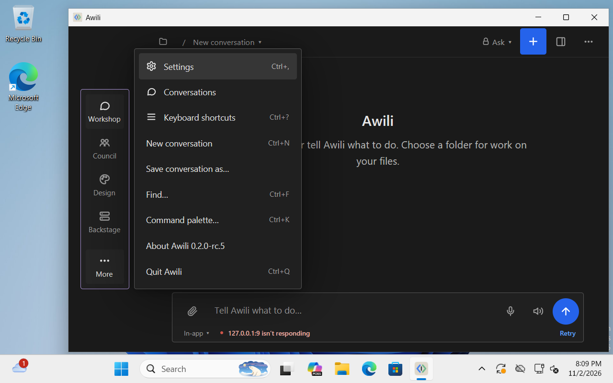
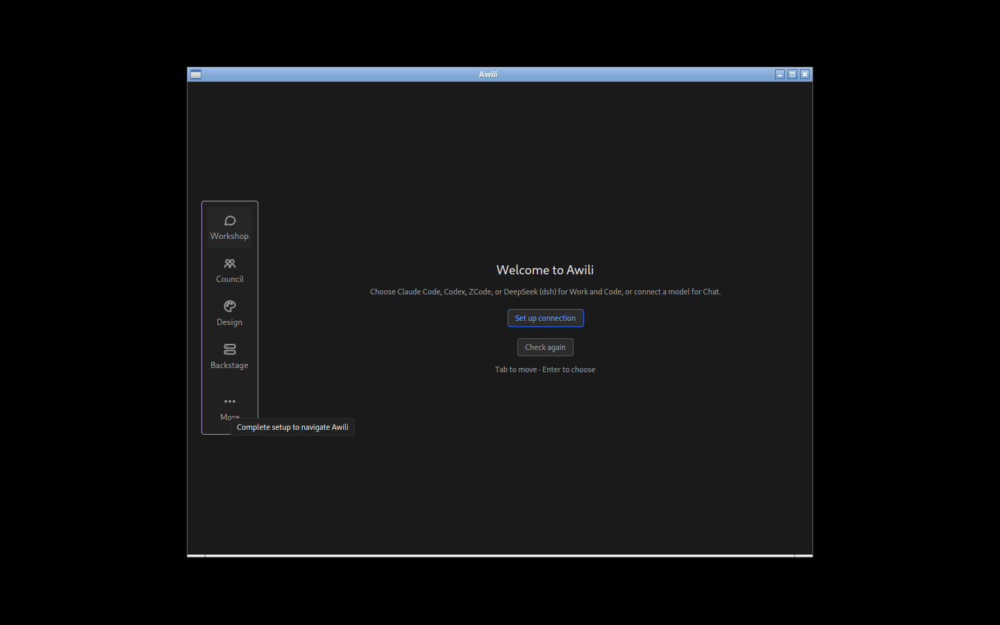

# Awili

Awili is a native desktop workspace for working with AI. You give it a folder
and a task, and it runs the work with the AI tools you already use, showing you
each step and asking before it does anything risky. It is written in Rust with
the GPUI toolkit, so it is a real native app (no browser or web view inside),
and it runs on macOS, Windows and Linux.

The current source is release candidate `0.3.0-rc.2` (see [changes](CHANGELOG.md)). It works day to day for its author,
but expect rough edges.

> **Written by AI.** Almost all of Awili's code, tests, packaging scripts and
> documentation, this README included, were written by AI models working as
> coding agents: Anthropic's Claude models (through Claude Code), OpenAI's
> Codex, and models from DeepSeek, Zhipu (GLM) and Alibaba (Qwen). Changes were
> also reviewed by AI models other than the one that wrote them. A human
> (the project's owner) chose what to build, made the decisions, tested the
> app and approved releases, but did not write most of the code by hand.
> Read it, test it and judge it with that in mind.

| Windows | Linux |
|---|---|
|  |  |

## What it does

- **Workshop**: a conversation tied to a folder, in a Work mode (an agent acts on
  the folder) or a Code mode. You see the plan and the tool calls, and approve
  or refuse risky steps.
- **Council**: send one message to several models at once (for example Claude
  Code, Codex, or an in-app model) and read their answers side by side.
- **Backstage**: Skills, Automations, Sessions, Connections and Health pages.
- **Design** is a placeholder for a later release.
- **Bring your own AI**. Awili does not include a model and has no account
  system. In Settings you add a provider (OpenAI, Anthropic or an
  OpenAI-compatible server such as Ollama) with your API key; the key is stored
  in the macOS Keychain, Windows Credential Manager or Linux Secret Service,
  and these providers power Council and Chat. Work needs Claude Code, Codex or
  a model server you run, installed and signed in by you.
- **Opt-in write sandbox (macOS only)**: an off-by-default setting wraps agent
  commands in a macOS sandbox profile that limits where they can write. It
  guards against mistakes; it is not a security boundary against a hostile
  agent. Windows and Linux have no agent sandbox yet.

## Privacy

Awili has **no telemetry, analytics or crash reporting**, and it does not phone
home. It talks only to the model servers and tools you configure. Your
conversations and settings are stored on your own computer. API keys you type in Settings
are kept in your operating system secret store (or come from environment
variables or files you name); they are not sent anywhere except to the service
you set them up for. Optional integrations (an optional external memory service, Outline and Gitea connectors, a "needs you" feed) are off
until you configure them.

## Install

Download the file for your system from the Releases page. The table below lists
the previously published `0.3.0-rc.1` installers; it does not imply they contain
the `0.3.0-rc.2` source fixes.

| System | Status | File |
|---|---|---|
| macOS (universal) | Release candidate, notarized | `Awili-0.3.0-rc.1-macos-universal.dmg` |
| Linux (x86_64) | Release candidate | `Awili-0.3.0-rc.1-linux-x86_64.tar.gz` |
| Windows 10/11 (x64) | **Preview**, unsigned | `Awili-0.3.0-rc.1-windows-x64.zip` |

### Before you start

Awili does its work through an AI tool you install and sign in to yourself.
Install **Claude Code** or **Codex** and sign in to it once from a terminal
before opening Awili. API keys for OpenAI, Anthropic or a compatible service are
optional; you add them in Settings, and they power Council and Chat.

### macOS (Apple Silicon and Intel), release candidate

1. Download `Awili-0.3.0-rc.1-macos-universal.dmg` and open it.
2. Drag **Awili** to **Applications**.
3. Open Awili from Applications. It is signed and notarized by Apple, so it
   opens without a security warning.

To remove it, drag Awili from Applications to the Trash. Settings and
conversations are in `~/Library/Application Support/Awili`.

### Windows 10/11 (x64), preview

1. Download `Awili-0.3.0-rc.1-windows-x64.zip` and unzip it anywhere (for
   example `Documents\Awili`).
2. Double-click `Awili.exe`.
3. Windows says "Windows protected your PC" because this build is **not
   code-signed**. Click **More info**, then **Run anyway**. (If you would rather
   not, build it from source; see below.)
4. If the welcome screen says Work isn't set up, check that Claude Code or Codex
   is installed and signed in, then click **Check again**.
5. Keep Work in **Plan first** mode (top right) so you see what it intends
   before it acts. Windows has no agent sandbox yet.

To remove it, delete the folder you unzipped, then `%APPDATA%\Awili` and
`%LOCALAPPDATA%\Awili`. Saved API keys are listed in Credential Manager under
`dev.awili.Awili`.

### Linux (x86_64), release candidate

1. Download `Awili-0.3.0-rc.1-linux-x86_64.tar.gz` and unpack it:
   `tar xzf Awili-0.3.0-rc.1-linux-x86_64.tar.gz`
2. In the unpacked folder, run `./install.sh`. It installs for your user only
   (no sudo) and adds Awili to your app menu. Or run `./awili-app` directly.
3. You need a Wayland or X11 desktop with Vulkan drivers (or Mesa's software
   renderer). To save API keys you also need a Secret Service keyring such as
   GNOME Keyring or KWallet. Built and tested on Fedora 44; other distributions
   are untested.

To remove it, run `./uninstall.sh` from the same folder. Your data in
`~/.local/share/awili` and `~/.config/awili` is kept; delete those folders too
if you want everything gone.

### First launch

The welcome screen checks for Claude Code or Codex. Pick how you want to connect
and follow the prompts. A sample configuration with every option explained is in
[`config.example.toml`](config.example.toml); the settings screen edits the same file.

## Known limits

- Release candidate software; formats and settings can still change.
- The first-run welcome screen has no key form: "Set up connection" opens
  Settings, where you set up providers (with API keys), choose an installed
  agent such as Claude Code or Codex, or scan your network for local model
  servers. The in-app engine endpoint is set in the config file.
- **Windows is a Preview.** It builds natively and is smoke-tested (welcome
  screen, focus, Ctrl shortcuts, owner-only file permissions, keys in Credential
  Manager), but about 500 of the roughly 3,000 app tests depend on Unix-only
  test fixtures and do not run on Windows yet. It is unsigned (SmartScreen:
  "More info", then "Run anyway"), has no agent sandbox, and is x64 only.
- Linux has been tested in Fedora 44 containers under Xvfb, not on a real
  desktop; Wayland and real-GPU setups are untested. There is no agent sandbox
  on Linux either.
- Voice input uses a local Whisper model that downloads on first use.
- Some settings and integrations in the code were built for the author's home
  network setup. They are off by default and harmless to ignore.

## Verifying downloads

SHA-256 of the 0.3.0-rc.1 files:

```
e7dab1119998d9505ac4d77e33ff91eb24800e54eacee029ef800b6a8b1b2a5b  Awili-0.3.0-rc.1-macos-universal.dmg
479b5e2fa187b8c123337cd271367d2bcadae6120682331da52c55b9a0df8314  Awili-0.3.0-rc.1-windows-x64.zip
9597c7ae49d9f118cfe35c6d6ba8945900f3085f77b52675d3ed3e54ae0aa2a6  Awili-0.3.0-rc.1-linux-x86_64.tar.gz
```

Check with `shasum -a 256 <file>` (macOS, Linux) or `Get-FileHash <file>`
(Windows PowerShell). The macOS app is notarized by Apple under the Developer
ID "Justin Bukoski".

## Build from source

You need:

- Rust, installed through [rustup](https://rustup.rs). The pinned version in
  `rust-toolchain.toml` is fetched automatically.
- **LLVM/clang 20** (libclang), used by the bindgen steps. Set
  `LIBCLANG_PATH` to its `lib` directory if it is not found, for example
  `/usr/lib64/llvm20/lib64` on Fedora. clang 20 is what the project is tested with.
- CMake and a C/C++ compiler (the voice feature builds whisper.cpp).
- macOS: Xcode with the **Metal toolchain** installed (Xcode 26 ships it as a
  separate component: `xcodebuild -downloadComponent MetalToolchain`).
- Linux: development packages for ALSA, fontconfig, freetype, Wayland, X11/xcb,
  xkbcommon, Vulkan, OpenSSL, libsecret, dbus, PipeWire and libdrm (Fedora
  names: `alsa-lib-devel fontconfig-devel freetype-devel wayland-devel
  libxcb-devel libxkbcommon-x11-devel vulkan-loader-devel openssl-devel
  libsecret-devel dbus-devel pipewire-devel libdrm-devel`).

```
git clone https://github.com/justinbukoski/awili.git
cd awili
cargo build --release -p awili-app
cargo test --workspace
```

The first build downloads a patched copy of GPUI and a few of its dependencies
from `github.com/justinbukoski` (see `Cargo.toml`, `[patch]`). On macOS,
`scripts/bundle-mac.sh` wraps the binary into `Awili.app`.

## Contributing and security

See [CONTRIBUTING.md](CONTRIBUTING.md) and [SECURITY.md](SECURITY.md).

## License

Dual licensed under either of [MIT](LICENSE-MIT) or
[Apache-2.0](LICENSE-APACHE), at your option. Copyright 2026 Justin Bukoski.
